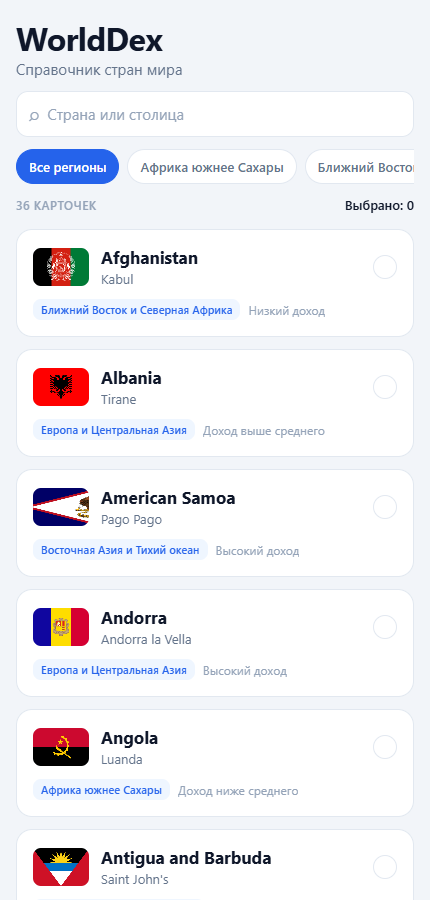
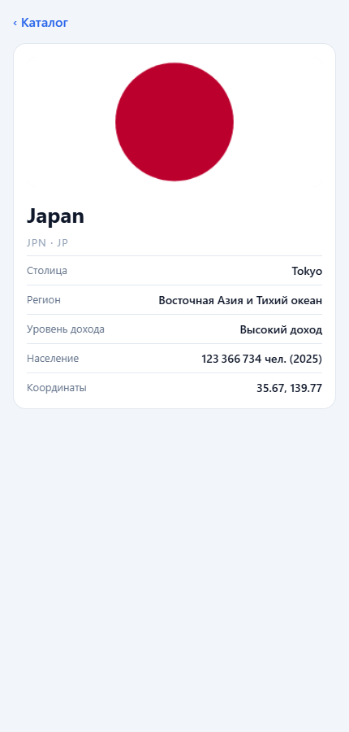

# WorldDex

Мобильный справочник стран мира. Учебный проект по дисциплине «Разработка мобильных приложений»,
Институт бизнеса и дизайна, 5 семестр.



## Что умеет

- Загружает список стран из World Bank API: флаг, столица, регион, уровень дохода.
- Показывает записи порциями по 50 и догружает следующие по прокрутке.
- Ищет по названию и столице, фильтрует по региону.
- Открывает карточку страны, которая сама запрашивает свои данные, включая население.
- Возвращается в каталог, сохраняя запрос, фильтр и позицию списка.
- Объясняет ошибку сети и предлагает повтор или демонстрационные данные.



## Для кого

Для студентов и школьников, которые готовят доклады по географии и экономике и ищут факты
о стране с телефона.

Основной сценарий: открыть приложение, ввести в поиск `japan`, открыть Japan, посмотреть столицу,
регион, уровень дохода и население, вернуться к списку с теми же условиями.

Подробнее — в [концепции](docs/product-concept.md).

## Стек

- React Native 0.86, Expo SDK 57
- TypeScript
- ESLint с правилами `eslint-config-expo`

Сеть сделана на `fetch` и пользовательском хуке, без внешних библиотек.

## Запуск

```bash
npm install
npm start
```

Отсканируйте QR-код в приложении Expo Go или нажмите `w`, чтобы открыть приложение в браузере.

Проект лежит в папке OneDrive, и после `npm install` Metro иногда падает с ошибкой
`EINVAL: readlink`. В этом случае запускайте с очисткой кэша:

```bash
npx expo start --clear
```

## Команды

| Команда | Что делает |
| --- | --- |
| `npm start` | запускает Metro |
| `npm run web` | открывает приложение в браузере |
| `npm run android` | запускает на Android-эмуляторе |
| `npm run typecheck` | проверяет типы |
| `npm run lint` | запускает ESLint |
| `npm test` | запускает тесты разбора ответа API |
| `npm run doctor` | проверяет конфигурацию Expo |
| `npm run bench` | сравнивает скорость массива и `Set` |

## Данные

- API: [World Bank Indicators API v2](https://datahelpdesk.worldbank.org/knowledgebase/articles/889392-about-the-indicators-api-documentation), ключ не нужен, лицензия CC BY-4.0.
- Флаги: [flagcdn.com](https://flagcdn.com).
- Демо-данные: `src/data/topics.ts`, включаются вручную при недоступности API.

Base URL можно переопределить переменной `EXPO_PUBLIC_API_BASE_URL`, пример — в `.env.example`.
Переменные `EXPO_PUBLIC_*` попадают в собранное приложение, поэтому годятся только для публичной
конфигурации, но не для секретов.

Полное описание запросов, примеры ответов и команды `curl` — в [docs/api.md](docs/api.md).

## Как ищет

У World Bank API нет серверного поиска по названию. Поэтому:

- пагинация и фильтр по региону выполняются **на сервере**;
- поиск по названию и столице выполняется **в приложении**, по уже загруженным записям.

Приложение об этом не умалчивает. Если поиск активен, а загружены не все страницы, на экране
появляется строка «Поиск идёт по загруженным записям» с кнопкой, которая догружает весь
справочник одним запросом. После этого поиск работает по всем 217 странам.

В справочнике 296 строк, но 79 из них — агрегаты вроде «High income» или «Europe & Central Asia».
Они отсеиваются по признаку `region.id === "NA"`, остаётся 217 стран и территорий.

## Как устроен код

Запрос всегда идёт по одной цепочке:

```
приложение  →  apiManager  →  transportService  →  сеть
```

`fetch` вызывается только в `transportService`. Проверить можно поиском:

```bash
grep -rn "fetch(" src --include=*.ts --include=*.tsx
```

Подробный разбор — в [docs/architecture.md](docs/architecture.md).

## Как смотреть логи

Запустите `npm run web`, откройте инструменты разработчика браузера, вкладку Console.
На каждый запрос пишутся два события:

```json
{"event":"http.start","requestId":"req-1","method":"GET","route":"/country"}
{"event":"http.end","requestId":"req-1","route":"/country","status":200,"durationMs":195,"outcome":"success"}
```

Чтобы разобрать одно действие: очистите консоль, выполните действие, отфильтруйте записи
по `requestId`. Логи пишутся только в режиме разработки. Заголовки, токены, тела ответов
и поисковые строки в лог не попадают.

## Структура

```
worlddex/
├── App.tsx                              корневой компонент
├── src/
│   ├── shared/api/
│   │   ├── transportService.ts          единственное место с fetch
│   │   ├── logger.ts                    http.start и http.end
│   │   ├── errors.ts                    коды ошибок
│   │   └── requestGuard.ts              защита от устаревшего ответа
│   ├── api/
│   │   ├── apiManager.ts                сборка тематических модулей
│   │   └── countries/
│   │       ├── countriesApi.ts          list, getById, getPopulation
│   │       └── countryDto.ts            проверка ответа и перевод в модель
│   ├── hooks/
│   │   ├── useCatalog.ts                список, поиск, фильтр, порции
│   │   └── useTopic.ts                  данные карточки
│   ├── screens/
│   │   ├── CatalogScreen.tsx            каталог и состояния
│   │   └── TopicScreen.tsx              карточка страны
│   ├── components/                      TopicCard, SearchField, RegionFilter
│   ├── types/topic.ts                   Topic, RegionCode, IncomeLevel
│   ├── data/                            демо-данные
│   └── theme.ts                         цвета и отступы
├── assets/                              иконки, скриншоты, резервные данные
├── docs/                                документация
└── reports/                             отчёты по практическим работам
```

## Как проверить

1. Открыть приложение — появится индикатор, затем список стран из сети.
2. Прокрутить вниз — догрузится следующая порция, дублей не будет.
3. Ввести `japan` — появится подсказка о границах поиска; нажать её, Japan найдётся.
4. Открыть Japan — карточка покажет население, полученное отдельным запросом.
5. Нажать «‹ Каталог» — запрос и позиция списка сохранятся.
6. Отключить интернет и нажать «Повторить» — появится «Нет связи с сервером» и кнопка демо-данных.

Полный протокол с фактическими результатами — в [docs/test-matrix.md](docs/test-matrix.md).

## Документация

- [Концепция](docs/product-concept.md)
- [Backlog](docs/backlog.md)
- [API справочника](docs/api.md)
- [Устройство сетевой части](docs/architecture.md)
- [Протокол проверок](docs/test-matrix.md)
- [Среда разработки](docs/environment.md)
- [Git-процесс](docs/git-workflow.md)
- [Ретроспектива](docs/retrospective.md)
- [CHANGELOG](CHANGELOG.md)
- Отчёты: [№ 0](reports/REPORT-00.md), [№ 1](reports/REPORT-01.md), [№ 2](reports/REPORT-02.md)
