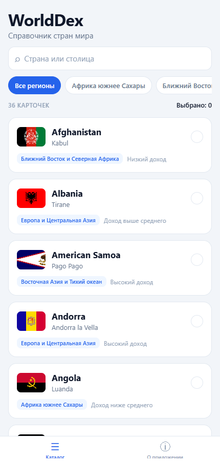
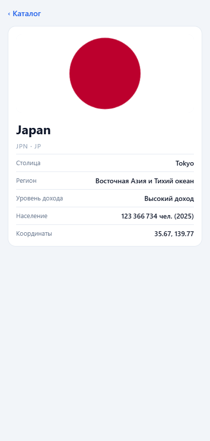

# WorldDex

Мобильный справочник стран мира. Учебный проект по дисциплине «Разработка мобильных приложений»,
Институт бизнеса и дизайна, 5 семестр.



## Что умеет

- Загружает список стран из World Bank API: флаг, столица, регион, уровень дохода.
- Показывает записи порциями по 50 и догружает следующие по прокрутке.
- Ищет по названию и столице, фильтрует по региону.
- Открывает карточку страны по нажатию, добавляет в избранное звёздочкой.
- Показывает избранное на отдельной вкладке; флаг один и тот же в каталоге, карточке и списке.
- Карточка сама запрашивает свои данные, включая население.
- Возвращается в каталог, сохраняя запрос, фильтр и позицию списка.
- Открывает карточку по прямой ссылке вида `/topic/JPN`, даже если список не загружали.
- Объясняет ошибку сети и предлагает повтор или демонстрационные данные.



## Для кого

Для студентов и школьников, которые готовят доклады по географии и экономике и ищут факты
о стране с телефона.

Основной сценарий: открыть приложение, ввести в поиск `japan`, открыть Japan, посмотреть столицу,
регион, уровень дохода и население, вернуться к списку с теми же условиями.

Подробнее — в [концепции](docs/product-concept.md).

## Стек

- React Native 0.86, Expo SDK 57
- Expo Router — навигация по структуре папок
- Redux Toolkit + RTK Query — глобальное состояние и серверный кэш
- TypeScript
- ESLint с правилами `eslint-config-expo`

Сеть по-прежнему на `fetch` внутри `transportService`. RTK Query вызывает `apiManager`,
а не обходит его через `fetchBaseQuery`.

## Запуск

```bash
npm install
npm start
```

Отсканируйте QR-код в приложении Expo Go или нажмите `w`, чтобы открыть приложение в браузере.

Проект лежит в папке OneDrive, и после `npm install` Metro иногда падает с ошибкой
`EINVAL: readlink`. В этом случае запускайте с очисткой кэша:

```bash
npx expo start --clear
```

## Команды

| Команда | Что делает |
| --- | --- |
| `npm start` | запускает Metro |
| `npm run web` | открывает приложение в браузере |
| `npm run android` | запускает на Android-эмуляторе |
| `npm run typecheck` | проверяет типы |
| `npm run lint` | запускает ESLint |
| `npm test` | запускает тесты API, избранного и селекторов |
| `npm run doctor` | проверяет конфигурацию Expo |
| `npm run bench` | сравнивает скорость массива и `Set` |

## Данные

- API: [World Bank Indicators API v2](https://datahelpdesk.worldbank.org/knowledgebase/articles/889392-about-the-indicators-api-documentation), ключ не нужен, лицензия CC BY-4.0.
- Флаги: [flagcdn.com](https://flagcdn.com).
- Демо-данные: `src/data/topics.ts`, включаются вручную при недоступности API.

Base URL можно переопределить переменной `EXPO_PUBLIC_API_BASE_URL`, пример — в `.env.example`.
Переменные `EXPO_PUBLIC_*` попадают в собранное приложение, поэтому годятся только для публичной
конфигурации, но не для секретов.

Полное описание запросов, примеры ответов и команды `curl` — в [docs/api.md](docs/api.md).

## Как ищет

У World Bank API нет серверного поиска по названию. Поэтому:

- пагинация и фильтр по региону выполняются **на сервере**;
- поиск по названию и столице выполняется **в приложении**, по уже загруженным записям.

Приложение об этом не умалчивает. Как только пользователь начинает искать, а загружены не все
страницы, справочник догружается целиком одним запросом — на экране при этом видно «Догружаем
справочник». После этого поиск работает по всем 217 странам.

В справочнике 296 строк, но 79 из них — агрегаты вроде «High income» или «Europe & Central Asia».
Они отсеиваются по признаку `region.id === "NA"`, остаётся 217 стран и территорий.

## Как устроен код

Запрос всегда идёт по одной цепочке:

```
экран / RTK Query  →  apiManager  →  transportService  →  сеть
```

`fetch` вызывается только в `transportService`. Проверить можно поиском:

```bash
grep -rn "fetch(" src --include=*.ts --include=*.tsx
```

Подробный разбор — в [docs/architecture.md](docs/architecture.md).

## Карта состояния

| Данные | Где живут | Срок жизни | Как меняются |
| --- | --- | --- | --- |
| Черновик поиска, регион, позиция списка | `useState` в `useCatalog` + `catalogMemory` | текущий запуск; переживают remount маршрутов | ввод и жесты на каталоге |
| Выбранные id, pending, ошибка по id | `favoritesSlice` | текущий процесс; после перезапуска пусто | только через `toggleFavorite` |
| Карточки, ответы API, статус запроса | кэш RTK Query (`catalogApi`) | пока есть подписчики / до перезапуска | `getTopics` / `getTopicById` через `apiManager` |
| Число и список избранного | selectors | вычисляются при каждом чтении | не хранятся в store |
| Данные между запусками | будущее локальное хранилище | за границами Sprint 5 | — |

Флаг избранного определяется только по `selected` в `favoritesSlice`. Отдельного `isFavorite`
в `Topic` и в ответе API нет.

### Избранное и учебный сервис

Избранное **не сохраняется** на диск и не уходит на сервер. `favoriteDemoService.set` ждёт
700 мс и подтверждает операцию. Чтобы проверить откат:

1. На карточке нажмите «Ошибка следующего изменения».
2. Сразу нажмите ★ — значение мелькнёт, затем вернётся назад с сообщением.
3. Повтор без новой кнопки ошибки проходит успешно.

Пока операция `pending` для id, кнопка ★ недоступна на всех экранах.

## Как смотреть логи

Запустите `npm run web`, откройте инструменты разработчика браузера, вкладку Console.
На каждый запрос пишутся два события:

```json
{"event":"http.start","requestId":"req-1","method":"GET","route":"/country"}
{"event":"http.end","requestId":"req-1","route":"/country","status":200,"durationMs":195,"outcome":"success"}
```

Чтобы разобрать одно действие: очистите консоль, выполните действие, отфильтруйте записи
по `requestId`. Логи пишутся только в режиме разработки. Заголовки, токены, тела ответов
и поисковые строки в лог не попадают.

## Структура

```
worlddex/
├── app/                                 маршруты и только они
│   ├── _layout.tsx                      Provider + Stack
│   ├── (tabs)/_layout.tsx               вкладки
│   ├── (tabs)/index.tsx                 каталог, адрес /
│   ├── (tabs)/favorites.tsx             избранное, адрес /favorites
│   ├── (tabs)/about.tsx                 о приложении, адрес /about
│   ├── topic/[id].tsx                   карточка, адрес /topic/JPN
│   └── +not-found.tsx                   неизвестный адрес
├── src/
│   ├── app/                             store.ts, hooks.ts
│   ├── features/
│   │   ├── posts/api/catalogApi.ts      RTK Query поверх apiManager
│   │   └── favorites/                   slice, команда, selectors, demo-сервис, UI
│   ├── shared/api/                      transportService, logger, errors
│   ├── api/                             apiManager, countriesApi, DTO
│   ├── hooks/                           useCatalog (локальный UI), useTopic
│   ├── screens/                         Catalog, Topic, About
│   ├── components/                      TopicCard, SearchField, RegionFilter
│   ├── types/topic.ts
│   ├── data/
│   └── theme.ts
├── assets/
├── docs/
└── reports/
```

## Адреса экранов

| Адрес | Экран |
| --- | --- |
| `/` | каталог |
| `/favorites` | избранное |
| `/about` | о приложении |
| `/topic/JPN` | карточка страны |
| любой другой | «Такой страницы нет» |

Прямые ссылки: в браузере `http://localhost:8081/topic/JPN`, в Expo Go
`exp://ХОСТ:8081/--/topic/JPN`, в сборке с нативным кодом `worlddex://topic/JPN`.
Проверялось в браузере Microsoft Edge после чистого старта.

Через адрес передаётся только код страны. Карточка грузит данные сама, поэтому ссылка работает,
даже если список ни разу не открывали. Подробнее — в [docs/navigation.md](docs/navigation.md).

## Как проверить

1. Открыть приложение — появится индикатор, затем список стран из сети.
2. Прокрутить вниз — догрузится следующая порция, дублей не будет.
3. Ввести `japan` — приложение само догрузит справочник, Japan найдётся без прокрутки.
4. Открыть Japan — карточка покажет население, полученное отдельным запросом.
5. Вернуться назад — запрос, фильтр и позиция списка сохранятся.
6. Открыть `http://localhost:8081/topic/RUS` в новой вкладке — карточка откроется сама.
7. Открыть `http://localhost:8081/unknown` — появится «Такой страницы нет».
8. Отключить интернет и нажать «Повторить» — появится «Нет связи с сервером» и кнопка демо-данных.
9. Нажать ★ у страны — флаг появится в каталоге, карточке и вкладке «Избранное».
10. Нажать «Ошибка следующего изменения», затем ★ — значение откатится с сообщением; повтор успешен.

Полный протокол с фактическими результатами — в [docs/test-matrix.md](docs/test-matrix.md).

## Документация

- [Концепция](docs/product-concept.md)
- [Backlog](docs/backlog.md)
- [API справочника](docs/api.md)
- [Устройство сетевой части](docs/architecture.md)
- [Навигация](docs/navigation.md)
- [Протокол проверок](docs/test-matrix.md)
- [Среда разработки](docs/environment.md)
- [Git-процесс](docs/git-workflow.md)
- [Ретроспектива](docs/retrospective.md)
- [CHANGELOG](CHANGELOG.md)
- Отчёты: [№ 0](reports/REPORT-00.md), [№ 1](reports/REPORT-01.md), [№ 2](reports/REPORT-02.md)
